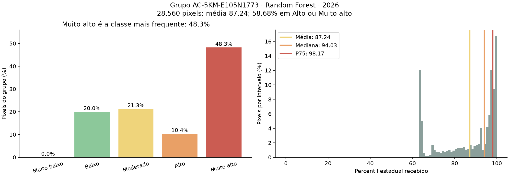
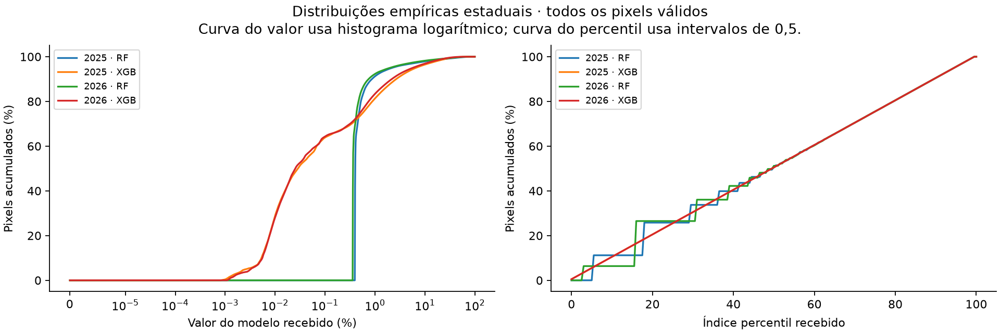
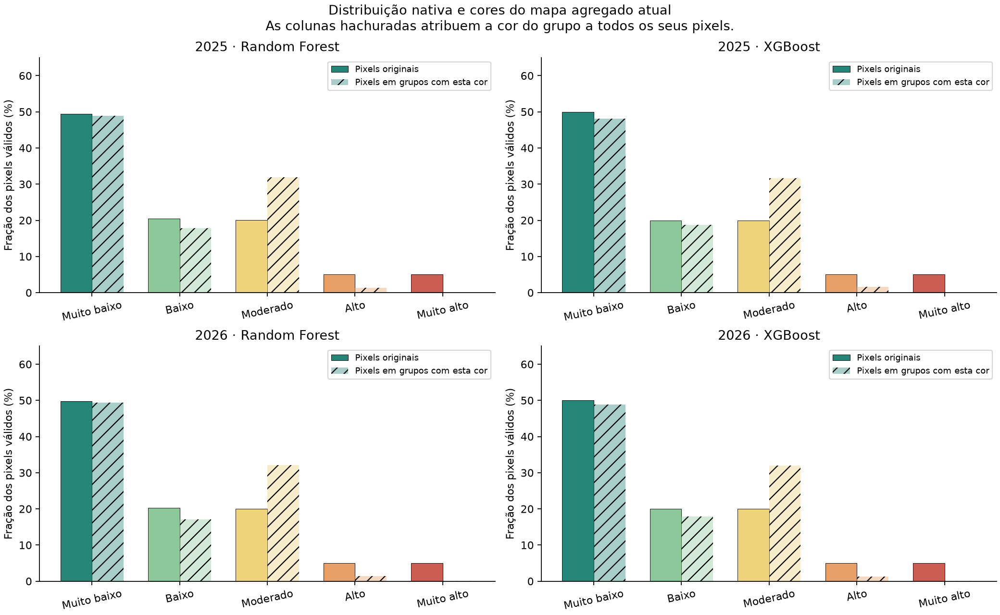
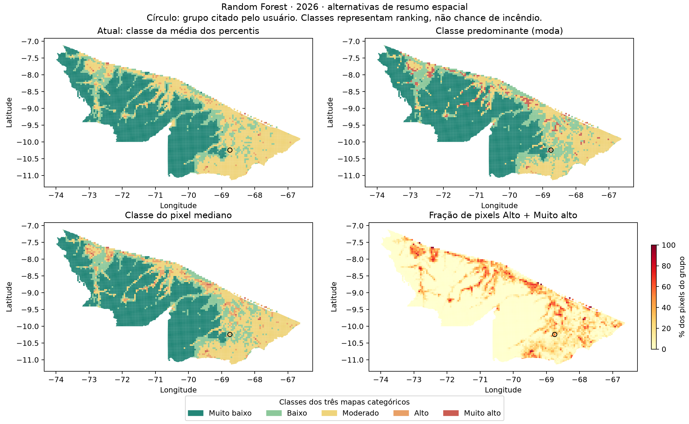

# Representatividade da agregação do Risco v4 em grupos de 5 km

Data: 27/10/2026, horário do Acre. Estudo descritivo dos produtos publicados de
2025 e 2026. A análise não altera o site, os GeoTIFFs ou as previsões recebidas.

## Conclusão

A média publicada foi conferida e está correta. Ela resume o nível médio dos
percentis dos pixels, mas não responde qual classe ocupa a maior parte do grupo
nem quanto da área concentra pixels altos. Essa diferença explica o exemplo.

Para melhorar a representação mantendo as cinco classes atuais, a alternativa
mais direta é **classe predominante, acompanhada da proporção que ocupa e da
distribuição das demais classes**. Para localizar concentrações de pixels altos,
a alternativa mais transparente é **fração de pixels com índice >= 90**.
São escolhas de resumo espacial, não novas probabilidades de incêndio.

Não há justificativa para forçar os escores ou percentis a uma distribuição
Poisson. A distribuição estadual já participa da construção dos percentis.
Ponderar pela quantidade de pixels equivale à média que já existe; ponderar pela
área real quase não a altera. Pesos inversos à frequência têm outros efeitos,
inclusive piorando o exemplo quando calculados dentro do próprio grupo.

## Universo e auditoria

- 416 setores COG originais: 208 de cada ano.
- 172.340.796 posições válidas de pixels por ano, aproximadamente 30 m.
- 6.393 grupos de 5 km por ano, com Random Forest e XGBoost.
- Foram lidas as quatro bandas na resolução original, sem usar overviews.
- Excluído NoData -9999; conferidos domínio, finitude e máscaras comuns.
- Os pixels foram reprojetados para EPSG:31979 e atribuídos aos mesmos grupos
  do importador. As contagens por classe coincidiram exatamente com o produto
  público; as médias coincidiram com tolerância absoluta de 1e-9.
- Quantis de todos os grupos são intervalos de histograma de largura 0,5 do
  índice. Como os limites 50/70/90/95 coincidem com os limites do histograma,
  suas classes são exatas para a definição de quantil adotada. No exemplo,
  os quantis numéricos foram calculados exatamente com todos os pixels.
- Mediana e P75 usam a inversa da CDF empírica, ou nearest rank. A moda
  categórica desempata pela classe mais baixa; houve apenas 1–2 empates por
  combinação de ano/modelo.
- Proporções e concordância cartográfica usam quantidade de pixels como
  aproximação de área. A análise separada de média ponderada por área usa
  áreas geodésicas WGS84 dos cantos de cada pixel.

Não foi avaliada a capacidade de prever queimadas. Concordância cartográfica
significa preservar classes dos pixels, não acertar incêndios observados.

## Cálculo atual, do modelo à cor

1. A banda 1 é o valor percentual recebido. O Random Forest traz a calibração
   temporal do professor; o XGBoost traz correção de amostragem, sem calibração
   equivalente. Não se multiplica novamente por 100.
2. A banda 2 é o percentil estadual recebido. O código do professor transforma
   os valores usando um histograma de 28.000 intervalos no logito:

   `q(pixel) = 100 * (pixels em intervalos inferiores + 0,5 * pixels no mesmo intervalo) / N`.

   Assim, valores no mesmo intervalo têm o mesmo índice. É uma aproximação de
   ranking com tratamento de empates por ponto médio, não uma Poisson.
3. Em cada grupo, o importador soma os percentis de todos os pixels válidos e
   divide por sua quantidade: `q_grupo = soma(q_pixel) / n`.
4. O frontend classifica esse número em [0,50), [50,70), [70,90), [90,95) e
   [95,100]. A cor pertence à **classe da média**, e não à classe mais frequente.

Referências do código:

- `incendio/importar_risco_professor_v4.py`: `aggregate_block`, contagens/somas,
  e gravação de `percentile_<modelo>` e `share_<modelo>_<classe>`.
- `entrega_professor_v4/1_codigo/pipeline/r30_avaliacao.py`: `Histograma.indice`.
- `frontend/src/components/RiskV4/RiskV4.tsx`: expressão `step` da camada
  `risk-v4-fill`, com cortes 50/70/90/95.

O grupo não é ranqueado novamente entre os 6.393 grupos. O número 87,24 é a
média das posições dos seus pixels perante o estado; não significa que o grupo
supera 87,24% dos grupos, nem que 87,24% da área vai queimar.

## Reprodução exata do exemplo

Grupo `AC-5KM-E105N1773`, Random Forest de 2026, centro representativo próximo
de longitude -68,748877 e latitude -10,244837.

| Classe do pixel | Quantidade | Proporção | Média do índice dentro da classe |
| --- | ---: | ---: | ---: |
| Muito baixo | 0 | 0,00% | — |
| Baixo | 5.721 | 20,03% | 64,5907 |
| Moderado | 6.081 | 21,29% | 81,2628 |
| Alto | 2.968 | 10,39% | 92,4430 |
| Muito alto | 13.790 | 48,28% | 98,1565 |
| Total | 28.560 | 100,00% | 87,2420 |

`(5721*64,5907 + 6081*81,2628 + 2968*92,4430 + 13790*98,1565) / 28560 ≈ 87,24`.

Os pixels baixos e moderados, somados, são 41,32% do grupo e puxam a média
para baixo de 90. Muito alto é a classe mais frequente, mas seus 48,28% não
constituem maioria absoluta. Alto e Muito alto, juntos, ocupam 58,68%.

| Resumo | Resultado | Interpretação |
| --- | ---: | --- |
| Média publicada | 87,241988 | Moderado; nível médio do índice |
| Média ponderada por área WGS84 | 87,241859 | Praticamente idêntica; Moderado |
| Moda das classes | Muito alto, 48,28% | Classe individual mais frequente |
| Mediana exata | 94,031158 | Alto; pixel central da distribuição ordenada |
| P75 exato | 98,169739 | Muito alto; posição do quartil superior |
| Fração com índice >= 90 | 58,6765% | Concentração de pixels Alto + Muito alto |
| Média com pesos inversos à frequência local | 84,113244 | Moderado; reduz o peso de Muito alto |
| Média com pesos inversos à frequência estadual | 93,580131 | Alto; valor alterado pelos pesos escolhidos |
| CDF estadual do valor médio da banda 1 | 98,096719 | Outra estatística; não é a média dos percentis |

O valor médio da banda 1 nesse grupo é 9,13635%. Ele é distinto do índice
percentil médio 87,24. As unidades e a semântica não devem ser misturadas.



## Quanto o efeito aparece nos produtos completos

Grupos com mais de 50% dos pixels em Alto ou Muito alto, mas média abaixo de 90:

| Ano | Random Forest | XGBoost |
| --- | ---: | ---: |
| 2025 | 196 | 185 |
| 2026 | 198 | 203 |

Grupos com mais de 50% exclusivamente em Muito alto, mas média abaixo de 95:

| Ano | Random Forest | XGBoost |
| --- | ---: | ---: |
| 2025 | 14 | 20 |
| 2026 | 23 | 28 |

Em Random Forest/2026, 75,52% dos pixels originalmente classificados como
Muito alto pertencem a grupos pintados de Moderado. Isso descreve a perda de
detalhe da agregação, não um erro no valor do pixel ou na previsão do modelo.

| Método, Random Forest/2026 | Grupos Alto | Grupos Muito alto | Concordância da cor do grupo com a classe dos pixels |
| --- | ---: | ---: | ---: |
| Média atual | 98 | 7 | 72,92% |
| Classe predominante | 35 | 186 | 75,79% |
| Classe da mediana | 273 | 30 | 74,50% |
| Classe do P75 | 639 | 366 | 68,03% |

A moda maximiza a concordância categórica em cada grupo: nenhuma outra cor
única acerta mais classes de pixels daquele grupo. Isso não garante preservar
as classes raras nem a ordem das distâncias entre as classes. A mediana tem
melhor resultado pelo critério de distância absoluta ordinal entre classes:
no RF/2026, erro 0,326, contra 0,339 da média e 0,342 da moda. Os dois critérios
respondem a perguntas diferentes.

No RF/2026, 1.258 grupos (19,68%) não têm nenhuma classe com mais de 50%.
Portanto, mesmo a moda precisa informar a proporção da classe predominante
e sinalizar grupos mistos. Ela ainda deixa parte importante dos pixels Muito
alto em grupos com outra cor. O P75 destaca concentrações altas e tende a
intensificar as cores, mas não equivale a representar a maioria.

## Distribuições estaduais

A distribuição bruta dos escores é assimétrica, com muitos valores pequenos e
uma cauda de valores grandes. Isso é diferente da distribuição do índice
percentil, construída para expressar posição relativa no estado.

| Ano/modelo | Média da banda 1, % | Intervalo da mediana, % | Média do índice percentil |
| --- | ---: | ---: | ---: |
| 2025 RF | 1,2173 | 0,3999–0,4050 | 49,9999 |
| 2025 XGB | 1,3508 | 0,02835–0,02871 | 50,0000 |
| 2026 RF | 1,0390 | 0,3614–0,3660 | 49,9999 |
| 2026 XGB | 1,1561 | 0,02497–0,02529 | 50,0000 |

As medianas da banda 1 são intervalos de histograma logarítmico, não quantis
exatos. Os valores do exemplo anterior são exatos.

As classes nativas ocupam aproximadamente 50%, 20%, 20%, 5% e 5% dos pixels.
Isso decorre dos próprios cortes de percentil, com diferenças por empates e
aproximação do histograma. Muito alto ter apenas 5% no estado não é uma
deficiência que exija reequilibrar probabilidades.

No RF/2026, cerca de 5,00% dos pixels nativos são Muito alto, mas só 0,0525%
dos pixels pertencem a grupos pintados de Muito alto pela média. Com moda,
2,8324% pertencem a grupos com essa cor. Comparar essas coberturas ajuda a
ver o efeito do resumo, mas não obriga o mapa agregado a reproduzir as mesmas
frações do mapa nativo.





## Por que Poisson e pesos de raridade não resolvem automaticamente

Poisson descreve contagens inteiras de eventos. Nossos escores e percentis
são valores contínuos limitados a [0,100]. Quase todos são não inteiros.
Transformá-los em Poisson mudaria a escala sem oferecer evidência de melhor
calibração ou representação da mistura espacial.

Mesmo tratando como variável a contagem de pixels altos por grupo, seria
necessário considerar quantidade de pixels válidos, heterogeneidade espacial
e dependência entre vizinhos. Entre os 5.837 grupos com pelo menos 28.000 pixels,
a razão variância/média da contagem de Alto + Muito alto foi aproximadamente
7.621 no RF/2026. Isso descreve forte heterogeneidade; não constitui teste
formal de uma Poisson condicional, nem autoriza tratar pixels como incêndios
independentes.

Ponderar as médias das classes por suas contagens já é equivalente ao cálculo
atual: `média = soma(n_classe * média_classe) / soma(n_classe)`.

Se cada pixel receber peso `1/n_classe` dentro do próprio grupo, cada classe
ocupada passa a ter o mesmo peso total. O resultado é a média simples das
médias das classes ocupadas. No exemplo, isso reduz 87,24 para 84,11.

Se os pesos vierem das frequências estaduais, Alto/Muito alto recebem peso
aproximadamente dez vezes maior que Muito baixo, e quatro vezes maior que
Baixo/Moderado. Esses pesos são uma decisão de destaque, não uma correção de
probabilidade. No exemplo, o resultado sobe para 93,58, mas ainda exige uma
justificativa para esse custo relativo das classes.

Ponderar pela área real também foi testado. A maior mudança em qualquer
grupo/modelo/ano foi inferior a 0,001 ponto do índice e nenhuma classe mudou.
Os pixels de um grupo já têm áreas praticamente iguais.

## Uma transformação empírica adicional: F(média do escore)

Também foi calculada, usando todos os pixels, a CDF empírica exata da banda 1
avaliada na média do escore de cada grupo. Ela responde: qual fração dos pixels
do estado tem valor menor ou igual a esse valor médio?

O mapa atual faz `média(F(escore_pixel))`, enquanto essa alternativa faz
`F(média(escore_pixel))`. A ordem das operações altera o resultado.
Neste experimento também muda a convenção de empates: a CDF exata usa
`menor ou igual`, enquanto o produto recebido usa o ponto médio de intervalos
de histograma. Assim, a comparação não isola exclusivamente a ordem das
operações; inclui essa diferença de transformação e precisão.

No exemplo, 87,24 passa a 98,10. Porém, no RF/2026, 3.061 dos 6.393 grupos
mudariam de classe e os grupos Muito alto passariam de 7 para 882. Cerca de
13,97% dos pixels passariam a pertencer a grupos com essa cor, embora a classe
nativa continue em aproximadamente 5%. No XGBoost/2026 seriam 273 grupos Muito
alto e 4,27% de cobertura. Isso não prova que a alternativa é ruim; mostra
que é uma mudança grande de estatística e de interpretação, não um conserto
neutro da média.

Ela também não ranqueia os grupos entre si: a referência continua sendo a
população de pixels. Se a intenção for ranquear grupos de 5 km, a distribuição
de referência deve ser explicitamente a dos próprios grupos, com decisão
clara sobre pesos por área e referência entre anos.

## Recomendação para o frontend

1. Manter os pixels, percentis e escores recebidos.
2. Na visão de 5 km com a legenda atual, oferecer classe predominante. Escrever
   "Muito alto é a classe mais frequente: 48,3%; grupo misto" no exemplo.
   Evitar chamar essa cor de classe de toda a área.
3. Exibir sempre a barra de composição das cinco classes e o indicador
   "58,7% dos pixels em Alto ou Muito alto", em vez de escondê-los somente
   nas informações técnicas.
4. Oferecer a visão "Concentração de pixels altos", colorida por
   `share_high + share_very_high`, com legenda própria de 0–100% dos pixels.
   Nessa legenda, porcentagem significa fração da área aproximada, nunca
   chance de incêndio.
5. Manter média e valor do modelo como informações adicionais; rotular o
   número atual como "percentil médio dos pixels", não ranking recalculado
   do grupo. Mediana ou P75 podem ser opções analíticas identificadas.
6. Ao aproximar, continuar mostrando os pixels originais com suas classes.

Moda e concentração podem ser obtidas com as proporções já publicadas; não
exigem treinamento, previsão ou alteração dos COGs. Valores numéricos exatos
de mediana/P75 para todos os grupos exigiriam novos campos derivados dos
pixels; suas classes já podem ser identificadas pela distribuição publicada.

Para recalibrar probabilidades, seria outro estudo: usar observações compatíveis
de MapBiomas Fogo, separação temporal/espacial e curvas de calibração. Alterar
a distribuição marginal não demonstra calibração. A presente análise não
escolhe uma regra por desempenho preditivo e não usa observações de 2026.



## Arquivos e reprodução

- `resumo_2025.json` e `resumo_2026.json`: estatísticas, matrizes de confusão
  cartográfica, métodos e resultados do exemplo.
- `grupos_2025.csv` e `grupos_2026.csv`: uma linha por grupo/modelo, contagens,
  médias, intervalos dos quantis e alternativas de classificação.
- `metodo.json`: definições e data da execução.
- Quatro PNGs: exemplo, mapas comparativos e distribuições estaduais.
- Script: `../analisar_representatividade.py`.

O relatório Markdown, resumos JSON, método e quatro figuras são versionados
como evidência compacta do estudo. Os CSVs detalhados e o PDF gerado permanecem
locais e ignorados pelo Git. Não é necessário refazer a leitura dos rasters
para consultar o relatório ou gerar seu PDF a partir das figuras versionadas.

Para instalar as dependências da análise no ambiente local:

```bash
incendio/.venv/bin/pip install -r incendio/risco_anual_v4/analises/requirements.txt
```

Para recalcular a análise completa:

```bash
MPLCONFIGDIR=/tmp/incendio-agregacao-mpl \
OPENBLAS_NUM_THREADS=1 OMP_NUM_THREADS=1 \
incendio/.venv/bin/python \
  incendio/risco_anual_v4/analises/analisar_representatividade.py
```

Dependências: NumPy, Rasterio, PyProj e Matplotlib. Os insumos são os produtos
canônicos locais, não os arquivos brutos de treinamento.

Para gerar o PDF do relatório existente:

```bash
incendio/.venv/bin/python \
  incendio/risco_anual_v4/analises/gerar_pdf_representatividade.py
```

O gerador de PDF usa ReportLab, Pillow e as fontes DejaVu instaladas no Linux
em `/usr/share/fonts/truetype/dejavu`. Ele não recalcula a análise nem executa
modelos. A saída local é `relatorio-representatividade-risco-v4.pdf`.

## Fontes metodológicas

- [NIST: distribuição Poisson](https://www.itl.nist.gov/div898/handbook/eda/section3/eda366j.htm).
- [NIST: quantis e diferentes convenções](https://www.itl.nist.gov/div898/software/dataplot/refman2/auxillar/quantile.htm).
- [Scikit-learn: calibração e curvas de confiabilidade](https://scikit-learn.org/stable/modules/calibration.html).
